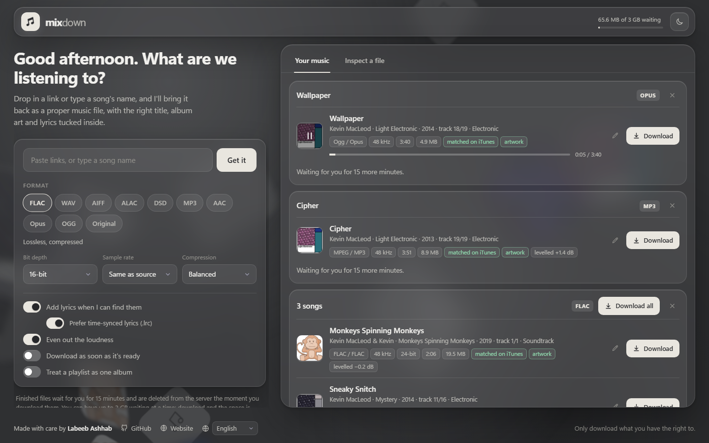
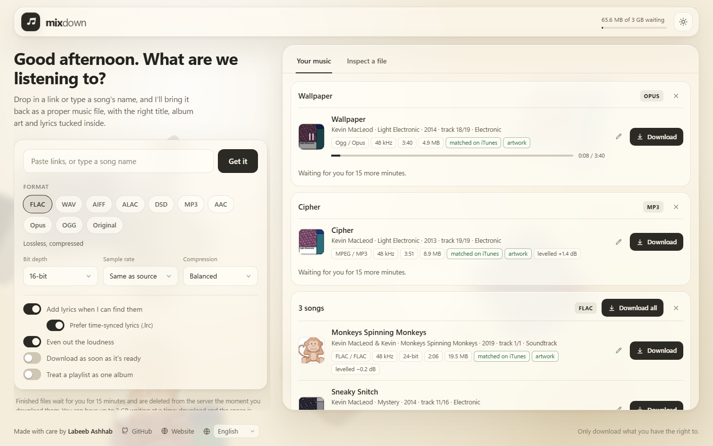
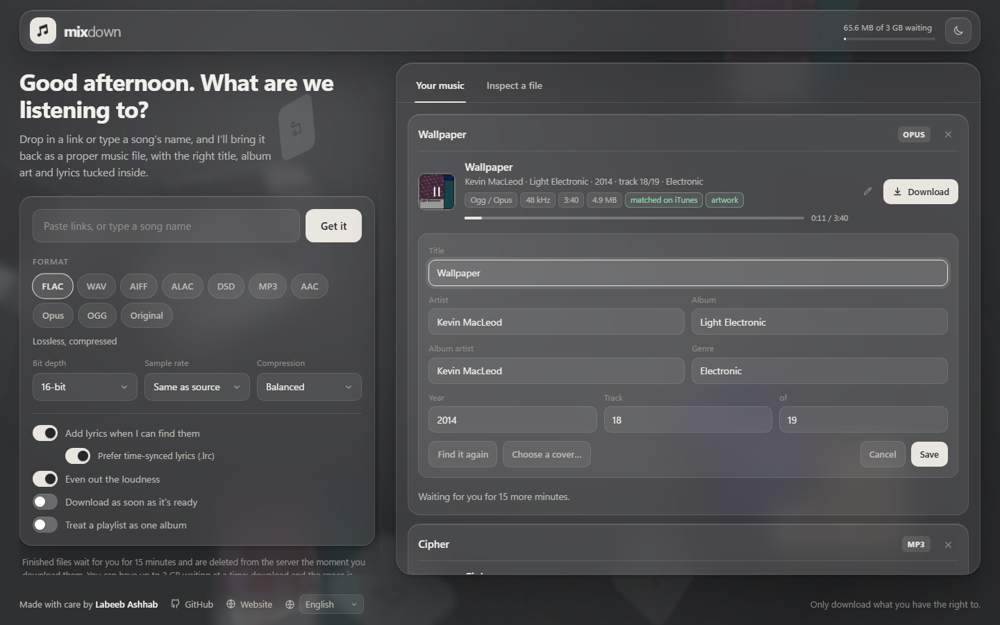

# Mixdown

Mixdown is a self-hosted web app. Paste a YouTube or SoundCloud link, or just type a song's name, pick a format, and get back a properly tagged audio file with album artwork and lyrics.



| Light theme | Fixing a match |
| --- | --- |
|  |  |

The music in these screenshots is by Kevin MacLeod (incompetech.com), licensed under Creative Commons Attribution 4.0.

Built by [Labeeb Ashhab](https://me.astroit.org) ([GitHub](https://github.com/LabeebAshhab)).

## Features

- **Ten output formats**, each with its own options: FLAC, WAV, AIFF, ALAC, DSD, MP3, AAC, Opus, OGG Vorbis, or the original stream untouched
- **YouTube, YouTube Music and SoundCloud** links: single songs, playlists and sets; a playlist downloads as one zip containing an album folder
- **Playlists with dead videos still work**: private and deleted videos are left out and the job says how many were skipped; a video that fails for another reason is marked, and the rest carries on
- **Whole songs from SoundCloud**: when SoundCloud offers only its 30-second preview of a song, the full song is fetched from YouTube instead and the track is marked "full song from YouTube"
- **Search by song name**: type a few words instead of a link and pick from the matches
- **Several links at once**: paste up to 25 song links together and get them back as one zip
- **Metadata extractor**: identifies the song and writes real release tags (title, artist, album, album artist, date, track and disc number, genre). It does not depend on one catalogue: iTunes is asked first, then Deezer and MusicBrainz, and, when you give the server a key for them, Tidal, Spotify, Discogs and Last.fm; what the matching catalogue leaves empty is filled in from the next ones
- **Album artwork** from the matched release, embedded in every format
- **Lyrics** looked up and embedded in the file, optionally time-synced (LRC text in the tag, an ID3 `SYLT` frame where the format has one, and a `.lrc` file next to the song)
- **Loudness levelling**: an optional single gain that brings each song to -14 LUFS (EBU R 128) without touching its dynamics or letting peaks pass -1 dBTP
- **Fix a match**: edit the title, artist, album, year, track number and genre of a finished file, look it up in the catalogues again with corrected names, or upload your own cover; the audio is copied, never converted twice
- **Preview player**: play any finished track in the page, in every format, before or after you download it, with a seek bar, a volume slider and mute; the volume is remembered
- **Installable**: add it to your phone or desktop as an app; on Android it then appears in the Share menu, so you can share a song straight from another app
- **Six languages**: English, Español, Français, Deutsch, Português and हिन्दी, picked from your browser and changeable in the footer
- **Metadata inspector and tag editor for your own files**: drop an audio file (MP3, FLAC, WAV, AIFF, M4A, Ogg, Opus, DSF or Matroska, up to 678 MB) to read its tags, artwork and audio properties. Keep it for a few minutes to correct its tags, look it up in the catalogues or give it a new cover, then download it again: the audio is copied bit for bit. One file per browser at a time; the server's administrator chooses which kinds are accepted, and can switch editing or the whole inspector off
- **Full-screen glass interface** with light and dark themes, an animated logo and a smooth theme switch
- **Album art backdrop**: the covers of your last songs drift in 3D behind the glass, blurred and very dim; they are kept in your browser only, never on the server
- **Storage limit per browser** (3 GB by default), with a cap per IP address; files are deleted from the server the moment they are downloaded
- **Playlists of any size in parts**: a playlist larger than the limit pauses when the space is full, lists the songs still waiting, and carries on by itself once the ready part is downloaded; each part is a zip with the same folder inside, and downloaded songs get a check mark
- **Hardened for public hosting**: see [Security](#security)
- **People online**: a small live number in the header shows how many visitors are using the app right now; it is a count only, kept in memory, and can be switched off
- **Privacy & Policy** at `/privacy`, one page linked in the footer. Its privacy part says what the server handles, which services it contacts and when everything is deleted; its usage policy part says what the app may be used for and what to expect from the files. Both state this server's own retention time and limits

## Formats and options

| Format | Options |
| --- | --- |
| FLAC | Bit depth 16 / 24, sample rate up to 192 kHz, compression level |
| WAV | Bit depth 16 / 24 / 32 / 32 float, sample rate up to 192 kHz |
| AIFF | Bit depth 16 / 24 / 32, sample rate up to 192 kHz |
| ALAC (.m4a) | Bit depth 16 / 24, sample rate up to 192 kHz |
| DSD (.dsf) | DSD64 or DSD128 |
| MP3 | 320 / V0 / 256 / 192 / 128 kbps, sample rate |
| AAC (.m4a) | 320 / 256 / 192 / 128 kbps, sample rate |
| Opus | 256 / 192 / 160 / 128 / 96 kbps |
| OGG Vorbis | Quality q3 to q10, sample rate |
| Original | No re-encoding; tags and artwork are still added |

A note on quality: YouTube serves lossy audio (Opus or AAC, usually 130 to 160 kbps). Converting it to a lossless or high-resolution format preserves that audio exactly but cannot add detail that was never there, and the files get much larger. "Original" keeps the stream as delivered.

FLAC stops at 24-bit on purpose. 32-bit FLAC is a recent addition to the format that few players read: Windows refuses such a file, and one was reported playing too fast on a hi-fi player. WAV and AIFF offer 32-bit for anyone who needs it.

FLAC files are written the way the reference encoder writes them, at every sample rate: 4096-sample blocks and a predictor order of 12 at most, which is the "subset" every FLAC decoder has to support. Left alone, ffmpeg would write 16384-sample blocks at 192 kHz, four times that size.

DSD output comes from a built-in encoder (`src/dsd.js`): a fifth-order sigma-delta modulator that writes standard stereo DSF files. A DSD64 file is about 42 MB per minute.

## Quick start (Docker)

```bash
docker compose up -d --build
```

Open <http://localhost:8080>.

### Trying it

- Type `kevin macleod carefree` and press Search, or paste a link.
- Paste several links separated by spaces or new lines to get them all in one go.
- Press the play button on a cover to listen, and set the volume next to the seek bar; press the pencil to correct the tags.
- Open "Inspect a file" and drop a song in to see what is inside it.
- The footer has the language menu and the link to the Privacy & Policy page.

To change settings, copy `.env.example` to `.env`, edit it, and run the same command again. To update yt-dlp later (needed when YouTube changes something), rebuild without the cache:

```bash
docker compose build --no-cache
```

### Proxmox LXC

1. Create a Debian or Ubuntu LXC with **nesting** enabled (Options → Features → nesting).
2. Install Docker inside it: `curl -fsSL https://get.docker.com | sh`
3. Clone this repository and run `docker compose up -d --build`.
4. Browse to `http://<lxc-ip>:8080`.

### Putting it on the internet

Put a reverse proxy with HTTPS in front of it (Caddy, nginx, Traefik or a Cloudflare Tunnel), then set these in `.env`:

```
TRUST_PROXY=1
COOKIE_SECURE=1
```

`TRUST_PROXY` matters: without it, every visitor appears to come from the proxy's address and they all share one rate limit and one storage limit. Set `ACCESS_PASSWORD` if the site is meant only for you.

The inspector takes files of up to `MAX_UPLOAD_MB` (678 MB), but never in one request: the page sends them in pieces of `UPLOAD_CHUNK_MB` (8 MB). That is what lets a large file through Cloudflare, which refuses any single request over 100 MB on its Free and Pro plans. The proxy only has to allow one piece: for nginx set `client_max_body_size 16m;` (its default of 1 MB is too small); Caddy and Traefik need nothing.

Set `PUBLIC_URL` to the site's address (for example `https://music.example.com`) so that a link to it shared in a chat or on a social site shows the preview image (`public/og.png`). Installing the app and its Share menu entry also need HTTPS.

### Install it as an app

Open the site in Chrome, Edge or Safari and choose "Install" or "Add to Home Screen". On Android the installed app is listed in the system Share menu: share a song from YouTube or SoundCloud to Mixdown and the link is placed in the field, ready for you to press Get it. A shared link never starts a download by itself.

## Run without Docker

Requires Node.js 20+, plus [yt-dlp](https://github.com/yt-dlp/yt-dlp) and [ffmpeg](https://ffmpeg.org) 6.1 or newer on your `PATH`.

```bash
npm ci
```

```bash
npm start
```

## Configuration

All settings are environment variables; `.env.example` lists every one with its default. The main ones:

| Variable | Default | Purpose |
| --- | --- | --- |
| `ACCESS_PASSWORD` | empty | Require a password to use the app |
| `TRUST_PROXY` | empty | Number of reverse proxies in front of the app |
| `QUOTA_GB` | `3` | Space one browser may have waiting to be downloaded |
| `IP_QUOTA_GB` | twice `QUOTA_GB` | Space all the browsers at one IP address may have waiting together |
| `TOTAL_STORAGE_GB` | `20` | Space all visitors together may use |
| `FILE_TTL_MINUTES` | `15` | How long a finished file waits before it is deleted, and how long a paused playlist waits before it is cancelled |
| `MAX_TRACKS` | `100` | Tracks taken from one playlist |
| `MAX_PLAYLIST_GB` | `30` | Most that one link may add up to, over all its parts |
| `MAX_LINKS` | `25` | Song links accepted in one paste |
| `MAX_TRACK_MINUTES` | `90` | Longest single video |
| `MAX_CONCURRENT` | `2` | Links processed at the same time |
| `RATE_CONVERT_PER_MIN` | `5` | New links per minute, per visitor |
| `RATE_SEARCH_PER_MIN` | `10` | Searches per minute, per visitor |
| `RATE_EDIT_PER_MIN` | `20` | Tag edits, lookups and cover uploads per minute, per visitor |
| `LYRICS` / `METADATA_LOOKUP` | `on` | Turn the lookups off |
| `SEARCH` | `on` | Search by song name |
| `INSPECT` | `on` | The metadata inspector; `off` removes its tab and refuses every upload to it |
| `INSPECT_TYPES` | all | Kinds of file the inspector accepts, from `mp3 flac wav aiff m4a ogg opus dsf mka`; judged by the file's bytes, not its name |
| `INSPECT_EDIT` | `on` | Let a visitor keep the file they inspect, correct its tags and download it again; `off` makes the inspector read-only (every file is deleted as soon as it has been read) |
| `MAX_UPLOAD_MB` | `678` | Largest file the inspector accepts |
| `UPLOAD_CHUNK_MB` / `UPLOAD_TIMEOUT_SEC` / `UPLOAD_TOTAL_MINUTES` | `8` / `120` / `30` | Size of the pieces a file is sent in, how long one piece may take, and how long the whole file may take |
| `RATE_INSPECT_PER_MIN` | `10` | Files offered to the inspector per minute, per visitor |
| `CATALOGUES` | all | The catalogues a song is looked up in, in order, from `itunes deezer tidal spotify musicbrainz discogs lastfm`; one without its key is skipped |
| `TIDAL_CLIENT_ID` / `TIDAL_CLIENT_SECRET` | empty | Key for Tidal; see [Catalogue keys](#catalogue-keys) |
| `SPOTIFY_CLIENT_ID` / `SPOTIFY_CLIENT_SECRET` | empty | Key for Spotify |
| `DISCOGS_TOKEN` | empty | Key for Discogs |
| `LASTFM_API_KEY` | empty | Key for Last.fm |
| `ITUNES_COUNTRY` | `US` | The country whose stores are searched (iTunes, Tidal, Spotify) |
| `SOUNDCLOUD_FALLBACK` | `on` | When SoundCloud gives only its 30-second preview of a song (those need Go+), fetch the whole song from YouTube instead; `off` makes that track fail with a message |
| `PREVIEW` / `PREVIEW_MINUTES` | `on` / `10` | The in-page player, and the longest preview kept per track |
| `ONLINE_COUNT` | `on` | The number of people online shown in the header; `off` hides it and keeps no check-ins |
| `LOUDNESS_LUFS` | `-14` | Level aimed for by "Even out the loudness" |
| `MAX_COVER_MB` | `10` | Largest image accepted as a new cover |
| `PUBLIC_URL` | empty | The site's https address, for link previews |
| `CREDIT_NAME`, `CREDIT_GITHUB`, `CREDIT_WEBSITE` | set | Footer credits |

## Catalogue keys

Out of the box a song is looked up in iTunes, then Deezer, then MusicBrainz; none of them needs a key. Four more catalogues are built in and stay switched off until you give the server a key of its own for them. Every key is free. Put it in `.env` and restart; the start-up log then lists the catalogue (`catalogues: Apple iTunes Search > Deezer > Tidal > ...`).

| Catalogue | Where to get the key | Settings | Good for |
| --- | --- | --- | --- |
| Tidal | [developer.tidal.com](https://developer.tidal.com): create an app | `TIDAL_CLIENT_ID`, `TIDAL_CLIENT_SECRET` | Album, date, track number, genre, large artwork |
| Spotify | [developer.spotify.com/dashboard](https://developer.spotify.com/dashboard): create an app | `SPOTIFY_CLIENT_ID`, `SPOTIFY_CLIENT_SECRET` | Album, date, track number, artwork. Since 2026 the account that owns the app needs Spotify Premium, and a search returns 10 songs at most |
| Discogs | [discogs.com/settings/developers](https://www.discogs.com/settings/developers): generate a personal access token | `DISCOGS_TOKEN` | Releases the stores do not list; year, genre and style |
| Last.fm | [last.fm/api/account/create](https://www.last.fm/api/account/create): the API key | `LASTFM_API_KEY` | Album and genre for obscure songs (its pictures are too small to embed and are not used) |

How they work together:

- The catalogues are asked one after another, in the order of `CATALOGUES` (iTunes first by default), and the search stops at the first good match. Most songs are seen by one or two catalogues.
- If the catalogue that matched leaves a detail empty (genre, year, track number, artwork), at most two of the others are asked for that same song, and the detail is taken only when the title, artist, version and length agree; details that belong to an album are taken only from the same album.
- A catalogue that refuses the server (a wrong key, too many requests) is left alone for a few minutes, and the others carry on.
- A key is sent only to the service it belongs to, in a request that is never redirected, and is never logged or sent to a browser. The server may contact only the hosts of the catalogues that are switched on.
- Amazon Music is not in the list: its API is a closed beta open to approved partners only.

These four were written from the services' published API descriptions and have not been run against the live services with a real key yet. A catalogue that answers in an unexpected way is skipped, so a problem there cannot break a download; check the log line `[metadata] <name> lookup failed` after adding a key.

## How storage works

- Every finished file counts towards its browser's limit (`QUOTA_GB`, counted by the session cookie) until it is downloaded. Everything held from one IP address is capped as well (`IP_QUOTA_GB`), because a cookie can be thrown away.
- A file is deleted from the server as soon as its download completes. The space is then free again.
- A playlist larger than the limit is made a part at a time. When the next song would not fit, the job stops and gives its worker back; the songs still to come are only titles and links in memory, so nothing more is fetched or stored. The page lists them under "Waiting for space" and offers the ready part as a zip (downloaded automatically when "Download as soon as it's ready" is on). When that download completes, the job rejoins the back of the queue and carries on. Every part's zip holds the same folder name and the songs keep their playlist numbers, so the parts unpack into one folder.
- A paused job whose ready part is not downloaded within `FILE_TTL_MINUTES` is cancelled as a whole: its files are deleted and the rest is never fetched. The time is counted from the visitor's last download, so a job that nobody is collecting cannot keep itself alive.
- A song larger than the whole limit is refused. So is one that cannot fit because other browsers at the same address hold the shared space while this browser has nothing of its own to download: waiting could not help.
- One link may add up to `MAX_PLAYLIST_GB` over all its parts.
- Files nobody downloads are deleted after `FILE_TTL_MINUTES`, but never while they are being sent. A sweep runs every minute and also removes anything left behind by a crash.
- A fully downloaded job stays for 45 seconds, showing its check marks, and is then removed.
- A file of a visitor's own that the inspector keeps for editing is counted exactly like a finished download: against the browser's limit and the address's limit, from the first byte of the upload (its whole size is set aside before anything is sent), and it is deleted when downloaded, removed, or `FILE_TTL_MINUTES` after the upload or the last saved change. A browser can hold one such file at a time.
- Each finished track also has a small MP3 preview for the player (about 0.7 MB per minute, at most `PREVIEW_MINUTES` long). Previews do not count towards a visitor's limit, do count towards `TOTAL_STORAGE_GB`, and are deleted with their job. A job you are listening to stays until its usual expiry even after its files are downloaded.
- Nothing is kept across restarts.

## Security

The app is written to be exposed to untrusted visitors.

**No command injection.** External tools (`yt-dlp`, `ffmpeg`) are started only through `src/proc.js`, which never uses a shell and passes arguments as an array. Formats and every option value come from a fixed allowlist (`src/formats.js`). A pasted link is reduced to the parts that identify it (a video or playlist id, or a SoundCloud account and song name), each checked against a strict pattern, and the URL is rebuilt from those parts (`src/sources.js`), so nothing a visitor types reaches a command line. Before that, a link must be short and made of printable ASCII only: spaces, control characters, backslashes, look-alike letters from other alphabets and `.`/`..` path steps are refused outright. Words typed into the search travel only as the text of a search, after a fixed `ytsearch8:` prefix and a `--` separator, so they cannot become an option or an address. They are first folded to ordinary characters, stripped of characters that hide or reorder text, and refused when they are shaped like an address.

**No server-side request forgery.** Only YouTube and SoundCloud links are accepted, playlist entries are checked the same way as pasted links, and yt-dlp is started with `--use-extractors` limited to those two sites, so its generic "fetch any page" extractor cannot run. When a match is looked up again, the artwork address it finds stays on the server and comes only from the catalogues. The server's own requests (catalogues, artwork, lyrics) go through `src/net.js`: HTTPS only, a fixed host allowlist that holds only the hosts of the catalogues this server is set up to use, DNS resolved at connect time with loopback, private, link-local and multicast addresses refused, redirects followed by hand (at most three, each re-checked), and limits on time and response size. A request that carries one of the server's catalogue keys is never redirected at all, so a key cannot be passed on to another address; keys are accepted from the environment only when they are made of plain key characters, and are never logged or sent to a page.

**Safe file handling.** Files on disk are named with random UUIDs inside a per-job folder; titles and artist names never become paths. Every path is checked to be inside the data folder. Download names are sanitised in the `Content-Disposition` header.

**Input validation.** Request bodies are checked against strict schemas (zod) that reject unknown fields, and query strings are read as plain `a=b` pairs, never as nested objects. Artwork, whether downloaded or uploaded as a new cover, is identified by its first bytes, size-limited, and re-encoded by ffmpeg before use, so only its pixels are kept. Edited tags are length-limited, stripped of control characters and escaped before they are written.

**Uploads to the inspector.** A stranger's file is the riskiest thing the server accepts, so it passes several layers (`src/inspect.js`). *Before anything is sent*, the browser announces the file's size: it must be inside `MAX_UPLOAD_MB`, and that much room is set aside under the same limits as a download (per browser, per address, whole server), so uploads cannot fill the disk past them. A browser may have one file at a time, an address two on their way in, the server six. *The file arrives in pieces* (`UPLOAD_CHUNK_MB`): each must be raw bytes, not a form and not compressed, of exactly the size and at exactly the place the server expects, within `UPLOAD_TIMEOUT_SEC`; the whole file must arrive within `UPLOAD_TOTAL_MINUTES`, and an upload that stops is deleted a little later. Only the session that started an upload can send into it or cancel it; to anyone else it does not exist. The first piece must already start like an accepted kind of audio file, or the upload ends there. *The file is written under a random name* and its own name is never sent. It is then read by a separate short-lived process (`src/inspect-child.js`) that may read only the app's own code and that one file: it cannot write, start programs, load native code or build code from text (Node's permission model, where the runtime has it), its memory is capped, and it is killed after 30 seconds. Only the kinds listed in `INSPECT_TYPES` are accepted, decided from the file's first bytes and again from what the reader really found, so renaming a file changes nothing. A file that crashes, hangs or exhausts that process takes down only that process. Every field of its answer is checked against a strict schema before it is used or sent on; embedded artwork is shown only when its bytes really are a JPEG, PNG, GIF or WebP; tag text has control and direction characters removed and is placed in the page as text, never as HTML. *A file that is only looked at is deleted at once.* One kept for editing (`INSPECT_EDIT`) becomes a job that only its own session can see, edit, download or remove, and is deleted like any download. When its tags are saved, nothing from the upload's tag area is copied as bytes: the tags are written anew from the schema-checked text, the picture is re-encoded by ffmpeg through a fixed image demuxer so that only its pixels remain, and the audio is stream-copied, never decoded. For that copy ffmpeg is told which demuxer to use (the one matching the kind the reader found), so it never guesses a format from hostile bytes, and it is limited to the `file` protocol, so a crafted file cannot make it open another file or an address; DSF files are not given to ffmpeg at all. The copy has a three-minute limit, its result may not be much larger than what came in, and it is read back by the confined reader before it replaces the file. No preview is made of an uploaded file. `INSPECT_EDIT=off` keeps the inspector read-only, and `INSPECT=off` removes the feature.

**Resource limits.** Token-bucket rate limits per address (overall, new links, searches, edits, uploads, password attempts); caps on simultaneous searches and edits; a worker queue with a concurrency cap; hard timeouts that kill any subprocess; limits on source size, track length, playlist length, upload size, and storage per browser, per address, per playlist and in total. A playlist paused for space holds no worker and fetches nothing, is cancelled if its ready part is left waiting, and resumes at the back of the queue.

**Isolation between visitors.** Each browser gets a random session id in an `HttpOnly`, `SameSite=Strict` cookie. Jobs can only be listed, downloaded, played, edited or removed by the session that created them. Space is counted per session, so visitors behind one address cannot use up each other's, and capped per address, so a new cookie does not buy more. Serve the site over HTTPS with `COOKIE_SECURE=1`: the cookie is what makes a visitor's waiting files theirs, and the server warns at start when `PUBLIC_URL` is set without it. Requests started by another site are refused, reads included (`Sec-Fetch-Site`), and writes must also carry this site's own `Origin`. A link shared into the installed app, or passed in the address, is only placed in the field: nothing starts until the visitor presses the button, so a crafted link cannot start a download on someone else's behalf. The number of people online is a total and nothing more: it counts sessions whose browser sent its cookie back, at most ten per address, so a flood of requests cannot inflate it.

**Headers and errors.** A strict Content-Security-Policy (no inline scripts or styles, no third-party hosts; media, manifest and service worker from the site itself only), `X-Content-Type-Options`, `X-Frame-Options: DENY`, `Referrer-Policy`, and HSTS over HTTPS. Error responses are short sentences; stack traces, paths and tool output stay in the server log.

**Service worker.** `public/sw.js` exists so the app can be installed and its shell opens offline. It is network-first, stores only a fixed list of public shell files, and never intercepts or caches `/api/`, so songs, artwork and session data never enter a cache.

**Container.** Runs as an unprivileged user on a read-only filesystem with all Linux capabilities dropped, `no-new-privileges`, and CPU, memory and process limits. The yt-dlp download is verified against its published checksum at build time.

What this does not cover: TLS (use a reverse proxy), protection against large distributed floods (use your proxy or CDN), and vulnerabilities in ffmpeg or yt-dlp themselves, which is why the container is locked down. Keep the image rebuilt regularly.

## How it works

1. `yt-dlp` downloads the best audio stream, its info and thumbnail. A song name is first turned into a short list of matches to pick from. A playlist is listed first, without its private and deleted videos; a download the site refuses for a passing reason is tried once more.
2. The metadata extractor (`src/metadata.js`) builds several readings of the video title, searches the catalogues one after another (iTunes, Deezer, MusicBrainz, and Tidal, Spotify, Discogs and Last.fm when they have a key), stops at the first good match, and scores candidates on title, artist and duration. What the winner leaves empty is asked of at most two more. Karaoke, tribute and cover versions are rejected, and the original studio album is preferred. Weak matches are refused: the file is then tagged from the YouTube data and marked "no catalogue match".
3. Album artwork and lyrics (from LRCLIB, with their time-synced form when asked for) are fetched for the matched song.
4. With "Even out the loudness" on, `ffmpeg` first measures the song (EBU R 128) and the difference to the target becomes one fixed gain. `ffmpeg` then converts the audio and makes the small preview for the player. Tags are written by ffmpeg where it does that well (FLAC, Ogg, MP4) and by a built-in ID3 writer elsewhere (MP3, WAV, AIFF, DSF).
5. The built-in reader (`src/reader/`) reads the finished file back, and the verified result is shown in the interface. The same reader powers the metadata inspector, where it runs in a separate, confined process. Correcting a match later runs steps 4 and 5 again on the finished file, with the audio copied as it is. The reader parses each format directly, with no parsing library, and its result follows the `format` / `common` / `native` layout of [music-metadata](https://github.com/Borewit/music-metadata), which the app used before.

6. The inspector (`src/inspect.js`) receives a visitor's own file in pieces, has the confined reader describe it, and either deletes it or keeps it as a one-track job. Editing such a file runs step 4 with the audio copied: the tags are written anew from the text the reader reported, the picture is re-encoded, and the result is read back by the confined reader.

Lookups send the song's title and artist to those services. Set `METADATA_LOOKUP=off` and `LYRICS=off` to disable them.

## Project layout

```
server.js          start-up and middleware
src/config.js      settings
src/security.js    headers, rate limits, sessions, safe names, error messages
src/net.js         guarded outbound requests
src/proc.js        subprocess runner (no shell, hard timeouts)
src/sources.js     accepted sites and link checking
src/formats.js     formats and options allowlist
src/pipeline.js    search, download, identify, level, convert, tag, verify, re-tag
src/jobs.js        queue, storage limit, cleanup
src/presence.js    the count of people online
src/routes.js      HTTP API and input schemas
src/metadata.js    catalogue matching
src/lyrics.js      lyrics lookup
src/tags.js        ffmetadata and ID3 writers
src/reader/        tag and audio-property reader (MP3, FLAC, WAV, AIFF, MP4, Ogg, DSF, Matroska)
src/inspect.js     the inspector: uploads in pieces, the confined process it reads files in, files kept for editing
src/inspect-child.js   that process: reads one upload, prints what it found
src/inspect-types.js   the kinds of file the inspector accepts and how they are recognised
src/dsd.js         PCM to DSD encoder
public/            interface (app.js), translations (lang.js), backdrop (backdrop.js), Privacy & Policy page (privacy.html),
                   installable-app files (manifest.webmanifest, sw.js, icons/), link preview (og.png)
docs/              screenshots
```

## Responsible use

Only download content you own, content under a licence that allows it (such as Creative Commons), or content you have permission to download. If you host this for other people, you are responsible for how it is used, for the terms of service of the sites it downloads from, and for the copyright law that applies to you. The usage policy page (`public/policy.html`, served at `/policy`) tells your visitors the same, with your server's limits filled in; edit it if your rules differ.

## License

[Apache License 2.0](LICENSE). Copyright 2026 Labeeb Ashhab.
