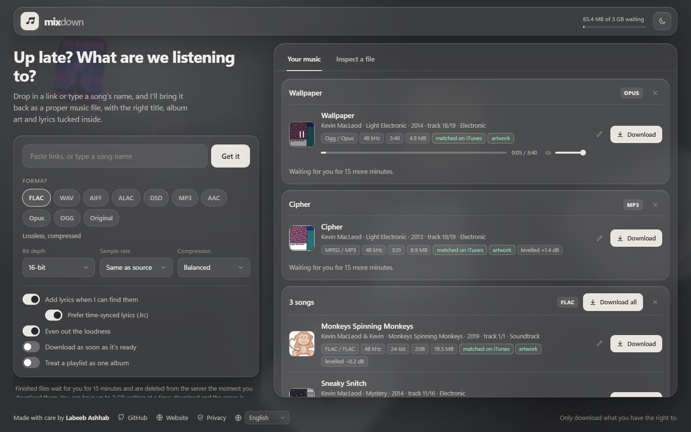
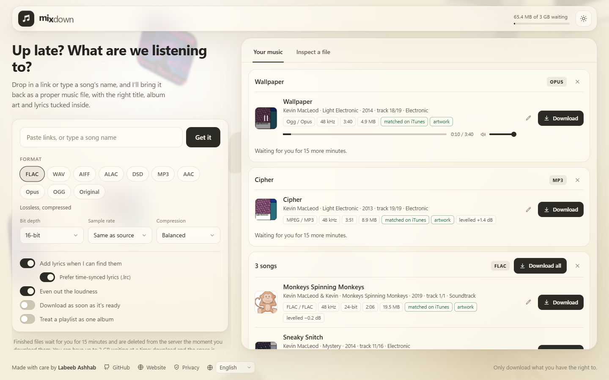
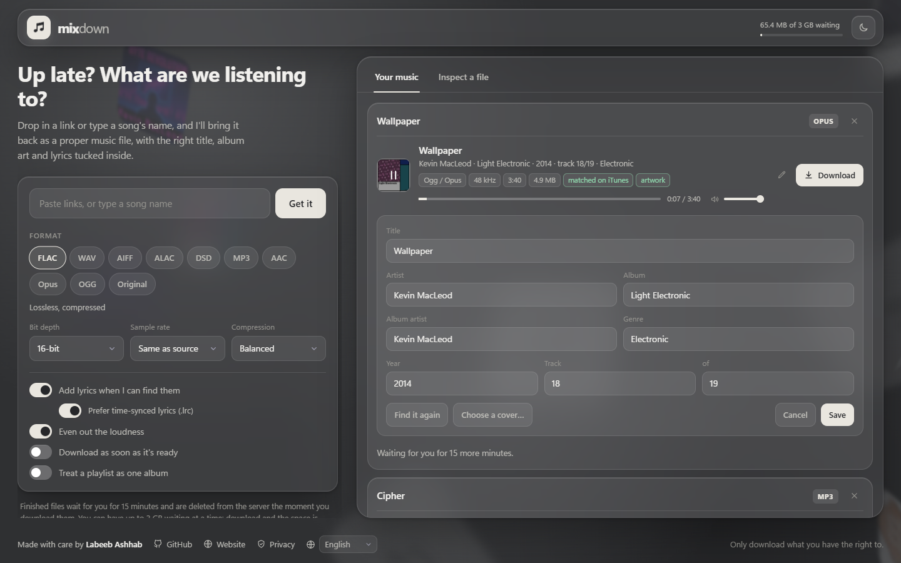

# Mixdown

Mixdown is a self-hosted web app. Paste a YouTube or SoundCloud link, or just type a song's name, pick a format, and get back a properly tagged audio file with album artwork and lyrics.



| Light theme | Fixing a match |
| --- | --- |
|  |  |

The music in these screenshots is by Kevin MacLeod (incompetech.com), licensed under Creative Commons Attribution 4.0.

Built by [Labeeb Ashhab](https://me.astroit.org) ([GitHub](https://github.com/LabeebAshhab)).

## Features

- **Ten output formats**, each with its own options: FLAC, WAV, AIFF, ALAC, DSD, MP3, AAC, Opus, OGG Vorbis, or the original stream untouched
- **YouTube, YouTube Music and SoundCloud** links: single songs, playlists and sets; a playlist downloads as one zip containing an album folder
- **Whole songs from SoundCloud**: when SoundCloud offers only its 30-second preview of a song, the full song is fetched from YouTube instead and the track is marked "full song from YouTube"
- **Search by song name**: type a few words instead of a link and pick from the matches
- **Several links at once**: paste up to 25 song links together and get them back as one zip
- **Metadata extractor**: identifies the song and writes real release tags (title, artist, album, album artist, date, track and disc number, genre)
- **Album artwork** from the matched release, embedded in every format
- **Lyrics** looked up and embedded in the file, optionally time-synced (LRC text in the tag, an ID3 `SYLT` frame where the format has one, and a `.lrc` file next to the song)
- **Loudness levelling**: an optional single gain that brings each song to -14 LUFS (EBU R 128) without touching its dynamics or letting peaks pass -1 dBTP
- **Fix a match**: edit the title, artist, album, year, track number and genre of a finished file, look it up in the catalogues again with corrected names, or upload your own cover; the audio is copied, never converted twice
- **Preview player**: play any finished track in the page, in every format, before or after you download it, with a seek bar, a volume slider and mute; the volume is remembered
- **Installable**: add it to your phone or desktop as an app; on Android it then appears in the Share menu, so you can share a song straight from another app
- **Six languages**: English, Español, Français, Deutsch, Português and हिन्दी, picked from your browser and changeable in the footer
- **Metadata inspector**: drop an audio file (MP3, FLAC, WAV, AIFF, M4A, Ogg, Opus, DSF or Matroska) to read its tags, artwork and audio properties; the server's administrator chooses which kinds are accepted, or switches it off
- **Full-screen glass interface** with light and dark themes, an animated logo and a smooth theme switch
- **Album art backdrop**: the covers of your last songs drift in 3D behind the glass, blurred and very dim; they are kept in your browser only, never on the server
- **Storage limit per visitor** (3 GB by default); files are deleted from the server the moment they are downloaded
- **Hardened for public hosting**: see [Security](#security)
- **A privacy page** at `/privacy`, linked in the footer: what the server handles, which services it contacts and when everything is deleted, stating this server's own retention time and limits

## Formats and options

| Format | Options |
| --- | --- |
| FLAC | Bit depth 16 / 24 / 32, sample rate up to 192 kHz, compression level |
| WAV | Bit depth 16 / 24 / 32 / 32 float, sample rate up to 192 kHz |
| AIFF | Bit depth 16 / 24 / 32, sample rate up to 192 kHz |
| ALAC (.m4a) | Bit depth 16 / 24, sample rate up to 192 kHz |
| DSD (.dsf) | DSD64 or DSD128 |
| MP3 | 320 / V0 / 256 / 192 / 128 kbps, sample rate |
| AAC (.m4a) | 320 / 256 / 192 / 128 kbps, sample rate |
| Opus | 256 / 192 / 160 / 128 / 96 kbps |
| OGG Vorbis | Quality q3 to q10, sample rate |
| Original | No re-encoding; tags and artwork are still added |

A note on quality: YouTube serves lossy audio (Opus or AAC, usually 130 to 160 kbps). Converting it to a lossless or high-resolution format preserves that audio exactly but cannot add detail that was never there, and the files get much larger. "Original" keeps the stream as delivered. 32-bit FLAC is not supported by every player.

DSD output comes from a built-in encoder (`src/dsd.js`): a fifth-order sigma-delta modulator that writes standard stereo DSF files. A DSD64 file is about 42 MB per minute.

## Quick start (Docker)

```bash
docker compose up -d --build
```

Open <http://localhost:8080>.

### Trying it

- Type `kevin macleod carefree` and press Search, or paste a link.
- Paste several links separated by spaces or new lines to get them all in one go.
- Press the play button on a cover to listen, and set the volume next to the seek bar; press the pencil to correct the tags.
- Open "Inspect a file" and drop a song in to see what is inside it.
- The footer has the language menu and the link to the privacy page.

To change settings, copy `.env.example` to `.env`, edit it, and run the same command again. To update yt-dlp later (needed when YouTube changes something), rebuild without the cache:

```bash
docker compose build --no-cache
```

### Proxmox LXC

1. Create a Debian or Ubuntu LXC with **nesting** enabled (Options → Features → nesting).
2. Install Docker inside it: `curl -fsSL https://get.docker.com | sh`
3. Clone this repository and run `docker compose up -d --build`.
4. Browse to `http://<lxc-ip>:8080`.

### Putting it on the internet

Put a reverse proxy with HTTPS in front of it (Caddy, nginx, Traefik or a Cloudflare Tunnel), then set these in `.env`:

```
TRUST_PROXY=1
COOKIE_SECURE=1
```

`TRUST_PROXY` matters: without it, every visitor appears to come from the proxy's address and they all share one rate limit and one storage limit. Set `ACCESS_PASSWORD` if the site is meant only for you.

Set `PUBLIC_URL` to the site's address (for example `https://music.example.com`) so that a link to it shared in a chat or on a social site shows the preview image (`public/og.png`). Installing the app and its Share menu entry also need HTTPS.

### Install it as an app

Open the site in Chrome, Edge or Safari and choose "Install" or "Add to Home Screen". On Android the installed app is listed in the system Share menu: share a song from YouTube or SoundCloud to Mixdown and the link is placed in the field, ready for you to press Get it. A shared link never starts a download by itself.

## Run without Docker

Requires Node.js 20+, plus [yt-dlp](https://github.com/yt-dlp/yt-dlp) and [ffmpeg](https://ffmpeg.org) 6.1 or newer on your `PATH`.

```bash
npm ci
```

```bash
npm start
```

## Configuration

All settings are environment variables; `.env.example` lists every one with its default. The main ones:

| Variable | Default | Purpose |
| --- | --- | --- |
| `ACCESS_PASSWORD` | empty | Require a password to use the app |
| `TRUST_PROXY` | empty | Number of reverse proxies in front of the app |
| `QUOTA_GB` | `3` | Space one visitor may have waiting to be downloaded |
| `TOTAL_STORAGE_GB` | `20` | Space all visitors together may use |
| `FILE_TTL_MINUTES` | `15` | How long a finished file waits before it is deleted |
| `MAX_TRACKS` | `100` | Tracks taken from one playlist |
| `MAX_LINKS` | `25` | Song links accepted in one paste |
| `MAX_TRACK_MINUTES` | `90` | Longest single video |
| `MAX_CONCURRENT` | `2` | Links processed at the same time |
| `RATE_CONVERT_PER_MIN` | `5` | New links per minute, per visitor |
| `RATE_SEARCH_PER_MIN` | `10` | Searches per minute, per visitor |
| `RATE_EDIT_PER_MIN` | `20` | Tag edits, lookups and cover uploads per minute, per visitor |
| `LYRICS` / `METADATA_LOOKUP` | `on` | Turn the lookups off |
| `SEARCH` | `on` | Search by song name |
| `INSPECT` | `on` | The metadata inspector; `off` removes its tab and refuses every upload to it |
| `INSPECT_TYPES` | all | Kinds of file the inspector accepts, from `mp3 flac wav aiff m4a ogg opus dsf mka`; judged by the file's bytes, not its name |
| `MAX_UPLOAD_MB` / `UPLOAD_TIMEOUT_SEC` | `100` / `120` | Largest file the inspector accepts, and how long an upload may take to arrive |
| `SOUNDCLOUD_FALLBACK` | `on` | When SoundCloud gives only its 30-second preview of a song (those need Go+), fetch the whole song from YouTube instead; `off` makes that track fail with a message |
| `PREVIEW` / `PREVIEW_MINUTES` | `on` / `10` | The in-page player, and the longest preview kept per track |
| `LOUDNESS_LUFS` | `-14` | Level aimed for by "Even out the loudness" |
| `MAX_COVER_MB` | `10` | Largest image accepted as a new cover |
| `PUBLIC_URL` | empty | The site's https address, for link previews |
| `CREDIT_NAME`, `CREDIT_GITHUB`, `CREDIT_WEBSITE` | set | Footer credits |

## How storage works

- Every finished file counts towards the visitor's limit until it is downloaded.
- A file is deleted from the server as soon as its download completes. The space is then free again, so a visitor can download 3 GB and start over.
- A track that would not fit is refused before it is converted.
- Files nobody downloads are deleted after `FILE_TTL_MINUTES`. A sweep runs every minute and also removes anything left behind by a crash.
- Each finished track also has a small MP3 preview for the player (about 0.7 MB per minute, at most `PREVIEW_MINUTES` long). Previews do not count towards a visitor's limit, do count towards `TOTAL_STORAGE_GB`, and are deleted with their job. A job you are listening to stays until its usual expiry even after its files are downloaded.
- Nothing is kept across restarts.

## Security

The app is written to be exposed to untrusted visitors.

**No command injection.** External tools (`yt-dlp`, `ffmpeg`) are started only through `src/proc.js`, which never uses a shell and passes arguments as an array. Formats and every option value come from a fixed allowlist (`src/formats.js`). A pasted link is reduced to the parts that identify it (a video or playlist id, or a SoundCloud account and song name), each checked against a strict pattern, and the URL is rebuilt from those parts (`src/sources.js`), so nothing a visitor types reaches a command line. Before that, a link must be short and made of printable ASCII only: spaces, control characters, backslashes, look-alike letters from other alphabets and `.`/`..` path steps are refused outright. Words typed into the search travel only as the text of a search, after a fixed `ytsearch8:` prefix and a `--` separator, so they cannot become an option or an address. They are first folded to ordinary characters, stripped of characters that hide or reorder text, and refused when they are shaped like an address.

**No server-side request forgery.** Only YouTube and SoundCloud links are accepted, playlist entries are checked the same way as pasted links, and yt-dlp is started with `--use-extractors` limited to those two sites, so its generic "fetch any page" extractor cannot run. When a match is looked up again, the artwork address it finds stays on the server and comes only from the catalogues. The server's own requests (catalogues, artwork, lyrics) go through `src/net.js`: HTTPS only, a fixed host allowlist, DNS resolved at connect time with loopback, private, link-local and multicast addresses refused, redirects followed by hand (at most three, each re-checked), and limits on time and response size.

**Safe file handling.** Files on disk are named with random UUIDs inside a per-job folder; titles and artist names never become paths. Every path is checked to be inside the data folder. Download names are sanitised in the `Content-Disposition` header.

**Input validation.** Request bodies are checked against strict schemas (zod) that reject unknown fields, and query strings are read as plain `a=b` pairs, never as nested objects. Artwork, whether downloaded or uploaded as a new cover, is identified by its first bytes, size-limited, and re-encoded by ffmpeg before use, so only its pixels are kept. Edited tags are length-limited, stripped of control characters and escaped before they are written.

**Uploads to the inspector.** A stranger's file is the riskiest thing the server accepts, so it passes several layers (`src/inspect.js`). The request must be raw bytes with a declared length inside the limit, not a form and not compressed, and it must arrive within `UPLOAD_TIMEOUT_SEC`; one upload per visitor and two in all are handled at a time. The file is written under a random name and its own name is never sent. It is then read by a separate short-lived process (`src/inspect-child.js`) that may read only the app's own code and that one file: it cannot write, start programs, load native code or build code from text (Node's permission model, where the runtime has it), its memory is capped, and it is killed after 30 seconds. Only the kinds listed in `INSPECT_TYPES` are accepted, decided from the file's first bytes and again from what the reader really found, so renaming a file changes nothing. A file that crashes, hangs or exhausts that process takes down only that process. Every field of its answer is checked against a strict schema before it is sent on; embedded artwork is shown only when its bytes really are a JPEG, PNG, GIF or WebP; tag text has control and direction characters removed and is placed in the page as text, never as HTML. The file is deleted whatever happens. `INSPECT=off` removes the feature.

**Resource limits.** Token-bucket rate limits per address (overall, new links, searches, edits, uploads, password attempts); caps on simultaneous searches and edits; a worker queue with a concurrency cap; hard timeouts that kill any subprocess; limits on source size, track length, playlist length, upload size, and per-visitor and total storage.

**Isolation between visitors.** Each browser gets a random session id in an `HttpOnly`, `SameSite=Strict` cookie. Jobs can only be listed, downloaded, played, edited or removed by the session that created them. Requests started by another site are refused, reads included (`Sec-Fetch-Site`), and writes must also carry this site's own `Origin`. A link shared into the installed app, or passed in the address, is only placed in the field: nothing starts until the visitor presses the button, so a crafted link cannot start a download on someone else's behalf.

**Headers and errors.** A strict Content-Security-Policy (no inline scripts or styles, no third-party hosts; media, manifest and service worker from the site itself only), `X-Content-Type-Options`, `X-Frame-Options: DENY`, `Referrer-Policy`, and HSTS over HTTPS. Error responses are short sentences; stack traces, paths and tool output stay in the server log.

**Service worker.** `public/sw.js` exists so the app can be installed and its shell opens offline. It is network-first, stores only a fixed list of public shell files, and never intercepts or caches `/api/`, so songs, artwork and session data never enter a cache.

**Container.** Runs as an unprivileged user on a read-only filesystem with all Linux capabilities dropped, `no-new-privileges`, and CPU, memory and process limits. The yt-dlp download is verified against its published checksum at build time.

What this does not cover: TLS (use a reverse proxy), protection against large distributed floods (use your proxy or CDN), and vulnerabilities in ffmpeg or yt-dlp themselves, which is why the container is locked down. Keep the image rebuilt regularly.

## How it works

1. `yt-dlp` downloads the best audio stream, its info and thumbnail. A song name is first turned into a short list of matches to pick from.
2. The metadata extractor (`src/metadata.js`) builds several readings of the video title, searches iTunes, Deezer and MusicBrainz, and scores candidates on title, artist and duration. Karaoke, tribute and cover versions are rejected, and the original studio album is preferred. Weak matches are refused: the file is then tagged from the YouTube data and marked "no catalogue match".
3. Album artwork and lyrics (from LRCLIB, with their time-synced form when asked for) are fetched for the matched song.
4. With "Even out the loudness" on, `ffmpeg` first measures the song (EBU R 128) and the difference to the target becomes one fixed gain. `ffmpeg` then converts the audio and makes the small preview for the player. Tags are written by ffmpeg where it does that well (FLAC, Ogg, MP4) and by a built-in ID3 writer elsewhere (MP3, WAV, AIFF, DSF).
5. The built-in reader (`src/reader/`) reads the finished file back, and the verified result is shown in the interface. The same reader powers the metadata inspector, where it runs in a separate, confined process. Correcting a match later runs steps 4 and 5 again on the finished file, with the audio copied as it is. The reader parses each format directly, with no parsing library, and its result follows the `format` / `common` / `native` layout of [music-metadata](https://github.com/Borewit/music-metadata), which the app used before.

Lookups send the song's title and artist to those public services. Set `METADATA_LOOKUP=off` and `LYRICS=off` to disable them.

## Project layout

```
server.js          start-up and middleware
src/config.js      settings
src/security.js    headers, rate limits, sessions, safe names, error messages
src/net.js         guarded outbound requests
src/proc.js        subprocess runner (no shell, hard timeouts)
src/sources.js     accepted sites and link checking
src/formats.js     formats and options allowlist
src/pipeline.js    search, download, identify, level, convert, tag, verify, re-tag
src/jobs.js        queue, storage limit, cleanup
src/routes.js      HTTP API and input schemas
src/metadata.js    catalogue matching
src/lyrics.js      lyrics lookup
src/tags.js        ffmetadata and ID3 writers
src/reader/        tag and audio-property reader (MP3, FLAC, WAV, AIFF, MP4, Ogg, DSF, Matroska)
src/inspect.js     the inspector's upload checks, and the confined process it reads files in
src/inspect-child.js   that process: reads one upload, prints what it found
src/inspect-types.js   the kinds of file the inspector accepts and how they are recognised
src/dsd.js         PCM to DSD encoder
public/            interface (app.js), translations (lang.js), backdrop (backdrop.js), privacy page (privacy.html),
                   installable-app files (manifest.webmanifest, sw.js, icons/), link preview (og.png)
docs/              screenshots
```

## Responsible use

Only download content you own, content under a licence that allows it (such as Creative Commons), or content you have permission to download. If you host this for other people, you are responsible for how it is used, for the terms of service of the sites it downloads from, and for the copyright law that applies to you.

## License

[Apache License 2.0](LICENSE). Copyright 2026 Labeeb Ashhab.
